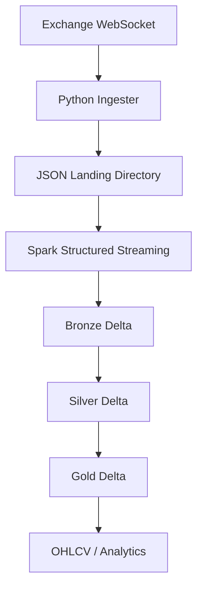

# Project 3 — Real-Time Crypto Lakehouse

## Goal

Build a vendor-neutral streaming lakehouse using **Apache Spark Structured Streaming + Delta Lake**.

The focus is streaming correctness and lakehouse architecture, not a Databricks-specific feature showcase.

## Tech stack

| Layer        | Technology                        |
| ------------ | --------------------------------- |
| Source       | Crypto exchange WebSocket         |
| Ingestion    | Python                            |
| Landing      | Local filesystem                  |
| Processing   | Apache Spark Structured Streaming |
| Table format | Delta Lake                        |
| Architecture | Bronze / Silver / Gold            |
| Runtime      | Docker / local                    |

### Architecture

Spark reads the landing directory as a streaming file source and writes Bronze; each subsequent layer is a separate streaming query with its own checkpoint.

## Storage decision

**Keep the core project fully local.**

Use the local filesystem for Delta tables rather than adding S3/GCS or another object-storage product to the core implementation.

Reasoning:

- the project's learning target is Spark streaming + Delta + event-time semantics
- cloud storage introduces IAM, credentials, networking and provider-specific debugging that do not materially improve those concepts
- Delta Lake officially supports local Spark development and local table paths
- a fully local Dockerized project is easier for a recruiter or reviewer to reproduce

A cloud-storage deployment can be an optional stretch goal after the core project is complete. Delta Lake supports object storage such as S3 and GCS, so the processing architecture can be adapted later without changing the core modeling concepts.

### Why not MinIO

MinIO was considered as a local S3-compatible storage layer, but it is intentionally excluded from the core project. The community repository was first archived in February 2026 and re-archived in April 2026, with the current product direction moving toward AIStor. Adding it would create another tool to learn without being central to the project's objective.

The project therefore stays simpler: **local Spark + local Delta first; cloud storage only as a later adapter if useful.**

## Data flows

The file source is read explicitly by Spark Structured Streaming; files do not flow into Delta automatically. Use an explicit source schema and a checkpoint location for each streaming query.

The landing directory should be rotated/archived after successful ingestion so the source directory does not grow indefinitely. This is separate from compaction of the Delta tables themselves.

### Bronze

Raw append-only trade events with minimal interpretation.

### Silver

Typed, validated and deduplicated trades.

Example quality rules:

- `trade_id` present
- `price > 0`
- `quantity > 0`
- valid event timestamp
- controlled duplicate policy

### Gold

One-minute OHLCV plus derived metrics such as VWAP and volume comparisons.

## Delta small-files management

The landing-directory small-files problem and the Delta-table small-files problem are treated separately. The ingester should batch JSON writes sensibly and archive processed landing files. Near the end of the build, run **one explicit `OPTIMIZE` pass** on representative Delta tables and record before/after file counts (and, where useful, query timing) in the README. No scheduled compaction infrastructure is part of the core scope.

Pin compatible versions of Python, Java, PySpark and `delta-spark` in the Docker image so the local environment is reproducible.

## The conceptual centerpiece: event time

The project must explicitly handle:

- late events
- out-of-order events
- websocket reconnects
- duplicate events
- watermarking
- the definition of when a candle is considered final

The README should document the chosen policy for late data and explain the alternatives considered.

## Data quality and observability

Track:

- websocket reconnects
- event gaps
- duplicate rate
- late-event rate
- watermark lag
- records dropped by quality rules
- micro-batch latency
- input/output record counts

## Deliberate exclusions

- no Databricks dependency
- no Kafka unless required by a later experiment
- no always-on production cluster
- no cloud deployment in the core challenge

The goal is to understand the underlying streaming architecture before adding managed services.

## Checkpoints (~6 days each)

Four rather than five: 25 days split cleanly, and this project's phases are naturally chunky.

1. **Trades survive the network** (`cp1-ingest`). Ingester with reconnect logic writes atomically batched JSON; one Spark streaming query reads the landing directory into Bronze with its own checkpoint. Done when a one-hour session including two scripted failure modes ends with bronze counts reconciling against the ingester's own written-record log. Simulate both a terminated connection and a silent stall (pause the container or block traffic); the ingester must detect the stall through heartbeat timeout, because reconnect logic that only handles clean closes passes tests and fails in production.

2. **Silver rejects garbage** (`cp2-quality`). Typed silver, dedup within the watermark, rejected-record accounting. Done when an injected negative price, a missing `trade_id` and a duplicate all show up in the reject metrics instead of silver.

3. **Candles reconcile with reality** (`cp3-candles`). Gold OHLCV with tumbling windows; the late-data policy chosen and written down. Done when the 1-minute candles reconcile with the exchange's own REST reference data within a documented tolerance, accounting for the chosen late-data policy. Aggregation conventions differ between sources, so the tolerance is part of the definition, not a hedge.

4. **System is operable and reproducible** (`cp4-operability`). Landing rotation, the one measured `OPTIMIZE` pass with before/after file counts, observability metrics, version-pinned image, README with the event-time discussion and alternatives considered. Done when a fresh clone goes from `docker compose up` to live candles, and the small-files numbers are in the README.

## Stretch ideas

Cloud object storage, Databricks adaptation, Kafka, or other managed services may be explored only after the local Spark + Delta core is complete.

## What this project proves

> I can reason about event-time streaming, build medallion-style transformations with Spark and Delta Lake, implement streaming data quality, and explain correctness trade-offs in the presence of duplicates, late and out-of-order events.
